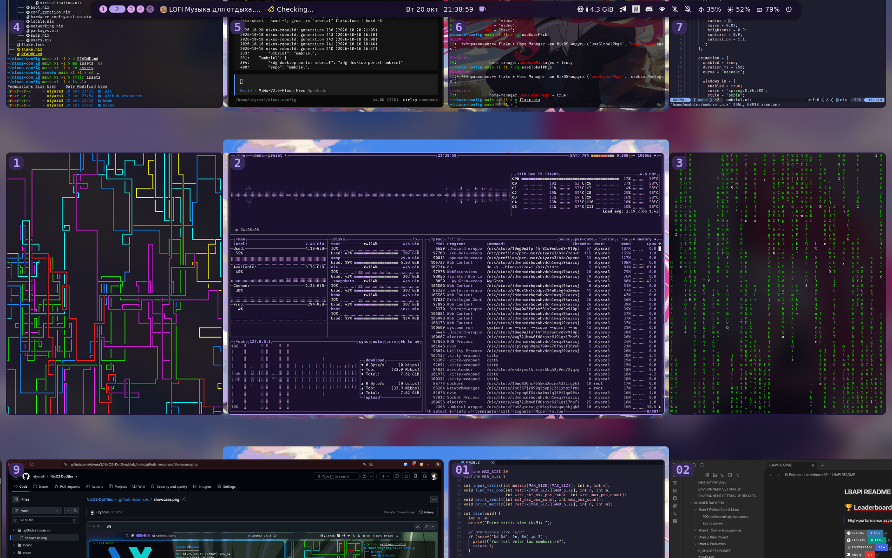
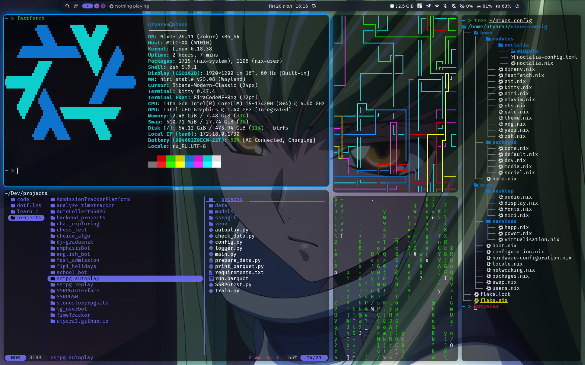

# My NixOS configuration

Декларативная конфигурация моего ноутбука на NixOS: flake, Home Manager, tiling-композитор **Umbriel** (также поддерживается **Niri**) и рабочая оболочка **Noctalia**.

## Showcase

### 10.2026


### 07.2026


## Обзор

- **ОС:** NixOS `nixos-unstable`, `system.stateVersion = "26.05"`
- **Управление:** flake + Home Manager как NixOS-модуль (`useGlobalPkgs`, `useUserPackages`)
- **Рабочий стол:** Umbriel (Wayland-композитор от noctalia-dev) + Noctalia (панель, лаунчер, уведомления, док); рядом лежит и конфиг Niri — с него была миграция
- **Шелл:** Zsh + oh-my-zsh + Powerlevel10k, zoxide, fzf, bat, eza
- **Редактор:** NixVim (Catppuccin Mocha, LSP, Telescope, Conform, Supermaven)
- **Железо:** ноутбук на Intel (VAAPI/Intel compute runtime/Vulkan), Btrfs с субволюмами и zram

## Структура

```
.
├── flake.nix              # входы и сборка nixosConfigurations.nixos
├── nixos/
│   ├── configuration.nix  # точка входа системы
│   ├── boot.nix           # systemd-boot (лимит 20 поколений), EFI
│   ├── networking.nix     # hostName "nixos", NetworkManager
│   ├── locale.nix         # Europe/Moscow, en_US + ru_RU
│   ├── swap.nix           # zram 75% + swapfile 24 ГБ
│   ├── users.nix          # пользователь utyara3 (Alexander), zsh, immutable users
│   ├── packages.nix       # системные утилиты + кастомные скрипты
│   ├── desktop/           # niri, umbriel, display/GDM-заглушка, pipewire, шрифты
│   ├── services/          # docker, tlp, v2rayA, flatpak, happ, power, postgresql
│   └── scripts/           # nr (rebuild + автокоммит), copy (буфер обмена)
└── home/
    ├── home.nix           # автоимпорт всех модулей из home/modules/
    ├── config/desktop.nix # общая карта приложений и биндов (общается для Niri и Umbriel)
    ├── packages/          # core / dev / media / social наборы программ
    └── modules/           # niri, umbriel, noctalia, nixvim, zsh, kitty, theme, yazi...
```

## Входы flake

| Вход | Назначение |
| --- | --- |
| `nixpkgs` | `nixos-unstable` |
| `home-manager` | домашняя конфигурация |
| `umbriel`, `noctalia` | композитор и рабочая оболочка (кэш Cachix) |
| `niri` | альтернативный композитор (старый сетап) |
| `nixvim` | Neovim как декларативный пакет |
| `zen-browser`, `ayugram-desktop` | браузер и Telegram-клиент из flakes |
| `voxtype` | диктовка голосом в текст (Whisper, язык `ru`) |
| `nix-flatpak` | Flatpak пакеты декларативно |
| `happ-nixos` | VPN-клиент Happ |

Кэши: `cache.nixos.org`, `ayugram-desktop`, `tg-owt`, `noctalia`, `umbriel` (Cachix) — подписаны в `nix.settings`.

## Рабочий стол

- **Композитор:** Umbriel — скроллинг/dwindle/master раскладки, blur, тени, скруглённые углы (18 px), gap 18, spring-анимации, цветовая палитра системы автоматически подтягивается из экосистемы Noctalia (например, меняется цвет рамки приложений. Он также может динамически изменяться в зависимости от обоев!!). Niri настроен параллельно с той же картой биндов.
- **Оболочка:** Noctalia (systemd-сервис, настройки в `home/modules/noctalia/noctalia-config.toml`): бар с воркспейсами, медиа, батареей, сетью и Bluetooth; док с авто-скрытием; control center, лаунчер, экран блокировки с блюром, рабочие виджеты, обои.
- **Greeter:** `noctalia-greeter` вместо GDM, раскладка `us,ru` с переключением на Caps Lock (сам Caps Lock режим переключается на Shift+CapsLock).
- **Тема:** GTK `adw-gtk3-dark` + иконки MoreWaita, курсор Bibata, шрифт Inter Display; QT подтягивается под GTK.
- **Порты:** `xdg-desktop-portal-umbriel` для скриншотов/скринкаста, gnome-портал и wlr как фолбэки; mime-ассоциации: PDF → Okular, картинки → imv, видео → mpv, HTML → Zen.
- **Терминал:** Kitty (полупрозрачный, Fira Code Nerd Font, powerline-табы).

## Клавиши (общая карта в `home/config/desktop.nix`)

| Бинд | Действие |
| --- | --- |
| `Mod+T` / `Mod+E` / `Mod+Shift+E` | kitty / kitty+yazi / Thunar |
| `Mod+B` / `Mod+D` / `Mod+A` | Zen / Discord / AyuGram |
| `Mod+Shift+V` / `F12` | VPN Happ / VoxType (диктовка) |
| `Mod+R` / `Mod+C` / `Mod+I` / `Mod+Esc` | лаунчер / буфер обмена / control center / блокировка |
| `Mod+H/J/K/L` (+Shift/Ctrl) | навигация, перемещение и разделение окон |
| `Mod+1…0`, `Print`, медиа-клавиши | воркспейсы, скриншоты, громкость/яркость |

## Системные особенности

- **Диск:** Btrfs, субволюмы `@`, `@home`, `@nix`, `@snapshots`, `compress=zstd`, `noatime`; отдельный EFI.
- **Питание:** TLP — пороги заряда 70–80% (продление жизни батареи), `performance` от розетки / `schedutil` от батареи, AHCI runtime PM, USB autosuspend.
- **Пакеты и обновления:** `system.autoUpgrade` раз в неделю с `--update-input nixpkgs`, GC раз в неделю (`--delete-older-than 30d`), `auto-optimise-store`.
- **Разработка:** Docker (+ lazydocker, compose), `nix-ld`, direnv + nix-direnv (молча), PostgreSQL 18 (пока выключен), Flatpak (Sober).
- **Игры:** Steam, Gamescope, Gamemode.
- **Сеть:** NetworkManager, v2rayA (порт 2017 в фаерволе), LocalSend.

## Пересборка

```sh
nr          # nix fmt -> nh os switch -> автокоммит в git
nr boot     # то же, но с активацией при следующей загрузке
```

`nr` — скрипт из `nixos/scripts/rebuild-script.nix`: форматирует файлы, собирает через `nh`, при успехе коммитит изменения с номером поколения.
Также доступен `copy <файл>` — кладёт в буфер путь и содержимое файла. Удобно для копирования файла с автоматически указанным абсолютным путем.

## Пользователь

`utyara3` (Alexander) — `wheel`, `networkmanager`, `docker`, `input`, `uinput`; пароль задан хэшем.
